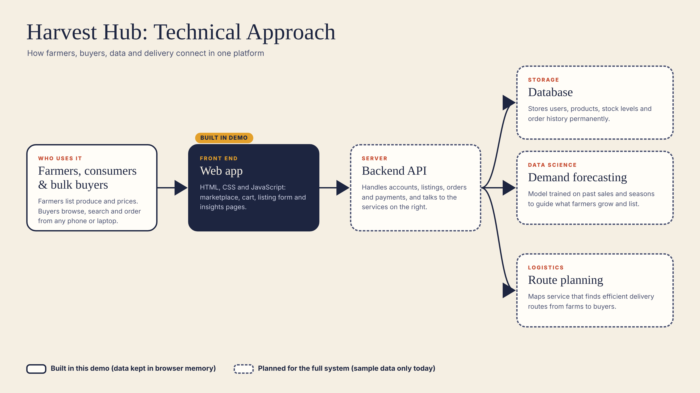

# Harvest Hub

A digital marketplace prototype that connects farmers and FPOs directly with consumers and bulk buyers, with demo tools for demand forecasting and delivery route planning.

**Smart India Hackathon Workshop**

| | |
|---|---|
| **Date** | 25-11-2026 |
| **Reference Number** | 26007333 |
| **Name** | Vishal Uppara |

## Problem Statement

**SIH 26033:** Multiple intermediaries reduce farmers' earnings and increase consumer prices.

- **Organization:** Ministry of Consumer Affairs, Food & Public Distribution
- **Theme:** Agriculture, FoodTech & Rural Development

## Features

- **Marketplace:** browse produce, search by name, filter by category and sort by price.
- **Farmer listings:** farmers add products with category, price per kg, quantity and farm name.
- **Shopping cart:** add and remove items, see running totals and place a demo order.
- **Demand forecast demo:** pick a product to see a sample demand level.
- **Delivery route demo:** enter a start and destination to see a sample delivery plan.

## How to Run

No installation or build step is needed.

1. Download `HarvestHub.html`.
2. Double-click it to open it in a web browser (Chrome, Edge, Firefox or Safari).

The page loads two fonts from Google Fonts. Without internet it falls back to Georgia and Segoe UI and still works.

## Project Files

| File | Description |
|---|---|
| `HarvestHub.html` | The complete prototype (HTML, CSS and JavaScript in one file) |
| `HarvestHub_Technical_Approach.png` | Diagram of the technical approach |
| `README.md` | This file |

## Technical Approach

The prototype is a single front-end page. The full system would add the following parts:

| Layer | Technology |
|---|---|
| Front end | HTML, CSS, JavaScript (React for the full version) |
| Backend | Python (FastAPI) or Node.js (Express) REST API |
| Database | PostgreSQL |
| Demand forecasting | Python with scikit-learn / Prophet, using past mandi price data |
| Route optimization | Google OR-Tools with a maps API such as OpenRouteService |
| Payments and alerts | UPI payment gateway, SMS / WhatsApp notifications |

## Prototype Limitations

This is a student project prototype. Please note:

- All data is sample data kept in browser memory. Products you add are lost when the page is refreshed.
- The demand forecast shows illustrative values only. It is not a trained AI model.
- The route planner shows a sample plan only. It does not calculate real roads, distances or times.
- The checkout is a demo. No payment is taken and no real order is placed.
- There is no login, backend or database yet.

## Future Work

- Backend API and database so listings and orders are saved.
- User accounts for farmers, FPOs and buyers.
- A forecasting model trained on Agmarknet and eNAM price data.
- Real route optimization with a maps service.
- UPI payments and SMS / WhatsApp order alerts.
- Regional language support and simple screens for low digital literacy.

## Author

**Vishal Uppara**
Reference Number: 26007333
